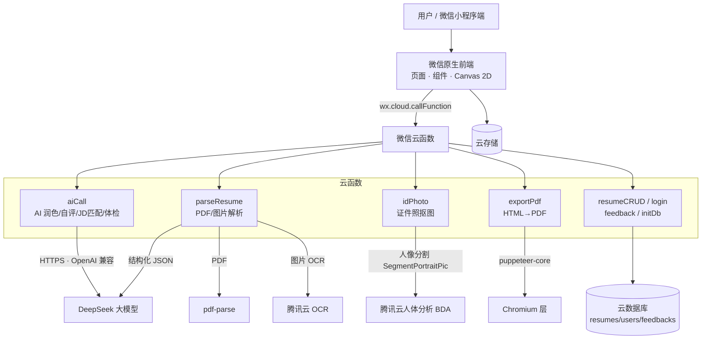

# 简途简历 AI · 微信小程序（AI 简历生成 / 岗位匹配 / 智能证件照）

> 一个面向大学生的 AI 简历制作微信小程序：微信原生 + 云开发，集成 DeepSeek 大模型与腾讯云 AI，
> 提供简历 AI 润色、自我评价生成、JD 岗位匹配度分析、简历 PDF/图片智能解析、AI 证件照抠图、
> 30 套专业模板、一键导出图片/PDF 等完整能力。**个人全栈独立开发项目（学习 / 作品集用途）。**

---

## ✨ 功能特性

- **AI 简历润色**：基于自研 Prompt 框架（STAR 法则 + 量化成果 + 禁止编造数据），将口语化经历改写为专业、动词开头、带量化结果的简历表达，并对缺失数据主动留占位符而非杜撰。
- **AI 自我评价**：根据个人信息与经历一键生成自我评价。
- **JD 岗位匹配度分析**：粘贴岗位 JD，大模型结合简历输出匹配度评分、技能命中/缺口、改进建议（前端以环形图 + 技能条可视化）。
- **简历体检**：逐条诊断简历问题并给出优化建议。
- **简历智能导入**：支持上传已有简历的 **PDF 或图片**，后端做文本提取（pdf-parse / 腾讯云 OCR）后交给大模型结构化，自动填充到编辑器。
- **AI 证件照**：接入腾讯云人体分析（人像分割）抠出透明前景，前端 Canvas 完成蓝/白/红换底与一寸/二寸/简历尺寸裁剪。
- **30 套简历模板**：商务、侧边栏、技术、创意等多种风格，每套含证件照位，基于 Canvas 2D 渲染。
- **可视化编辑器**：板块拖拽排序、重命名、添加 / 删除，实时预览。
- **一键导出**：Canvas 2D 导出高清图片，云函数 puppeteer 生成 PDF（环境不支持时自动降级长图）。
- **免费 / 会员体系**：免费用户可保存 5 份简历、每日 15 次 AI 润色、JD 匹配体验 1 次；模板全部免费。

---

## 🧱 技术栈

| 层 | 技术 |
|---|---|
| 前端 | 微信原生小程序（WXML / WXSS / JavaScript）、Canvas 2D |
| 后端 | 微信云开发（云函数 SCF、云数据库、云存储、云调用） |
| 大模型 | DeepSeek（`deepseek-chat`，OpenAI 兼容接口、JSON 结构化输出） |
| 计算机视觉 | 腾讯云人体分析 BDA（人像分割 `SegmentPortraitPic`）、OCR 通用印刷体识别 |
| PDF 处理 | pdf-parse（PDF 文本提取）、puppeteer-core（HTML → PDF） |
| 支付 | 微信虚拟支付（需企业主体，仓库中为前端 + 权益配置，下单云函数需自行接入） |

---

## 🏗️ 系统架构



---

## 📁 项目结构

```
jiantu-resume-ai/
├── miniprogram/
│   ├── app.js / app.json / app.wxss        # 小程序入口与全局配置
│   ├── components/
│   │   ├── ai-polish-modal/                # AI 润色弹窗
│   │   └── resume-render/                  # 简历模板渲染（30 套）
│   ├── pages/
│   │   ├── index/        # 首页 / 模板广场
│   │   ├── template/     # 模板选择
│   │   ├── resume-edit/  # 简历编辑器（板块拖拽/重命名/增删）
│   │   ├── resume-preview/ # 预览与导出
│   │   ├── jd-match/     # JD 岗位匹配
│   │   ├── id-photo/     # AI 证件照
│   │   ├── vip/          # 会员
│   │   ├── feedback/     # 问题反馈
│   │   ├── privacy/      # 隐私政策
│   │   └── mine/         # 个人中心
│   └── utils/
│       ├── config.js       # 免费/会员额度与定价集中配置
│       ├── canvas-export.js# Canvas 导出
│       ├── ai-limit.js     # AI 次数限流
│       └── ...
└── cloudfunctions/
    ├── aiCall/       # AI 统一中转（原生 https，无需额外依赖）
    ├── parseResume/  # PDF(pdf-parse)/图片(腾讯云 OCR) 提取 + DeepSeek 结构化
    ├── idPhoto/      # 腾讯云人体分析 BDA 人像分割
    ├── exportPdf/    # puppeteer-core 导出 PDF（失败降级长图）
    ├── resumeCRUD/   # 简历增删改查（含免费数量上限与归属校验）
    ├── login/        # openid 与会员状态
    ├── feedback/     # 问题反馈
    └── initDb/       # 数据库集合一次性初始化
```

---

## 🚀 本地部署与运行

### 1. 准备
- 安装 [微信开发者工具](https://developers.weixin.qq.com/miniprogram/dev/devtools/download.html)
- 注册一个小程序账号并开通 **微信云开发**（也可用测试号体验前端，但云函数 / 云数据库需要正式环境）

### 2. 导入项目
- 微信开发者工具 → 导入项目，选择本仓库根目录
- `project.config.json` 中的 `appid` 默认为 `touristappid`（游客模式），请改成**你自己的 AppID**

### 3. 配置云环境
- 在云开发控制台创建环境，复制环境 ID，填入 `miniprogram/app.js`：
  ```js
  globalData: {
    envId: '你的云开发环境ID',
    // ...
  }
  ```

### 4. 部署云函数
- 在开发者工具中右键 `cloudfunctions` 下每个云函数文件夹 → **上传并部署：云端安装依赖（不上传 node_modules）**
- 依赖含 `tencentcloud-sdk-nodejs` / `puppeteer-core` / `pdf-parse` 的函数，部署需 1-3 分钟，**只点一次**，等待完成
- 所有云函数超时统一设置为 **60 秒**

### 5. 配置云函数环境变量（关键）
在云开发控制台 → 云函数 → 对应函数 → 环境变量中配置：

| 云函数 | 环境变量 | 说明 |
|---|---|---|
| `aiCall` | `DEEPSEEK_API_KEY` | DeepSeek 开放平台 API Key |
| `parseResume` | `DEEPSEEK_API_KEY` | DeepSeek API Key（文本结构化） |
| `idPhoto` | `TENCENT_SECRET_ID` / `TENCENT_SECRET_KEY` | 腾讯云访问密钥（人像分割） |
| `parseResume` | `TENCENT_SECRET_ID` / `TENCENT_SECRET_KEY` | 腾讯云访问密钥（图片 OCR） |
| `exportPdf` | `CHROMIUM_PATH`（可选） | 自定义 Chromium 路径；不配置则降级长图 |

> 密钥仅保存在云函数环境变量中，**不要写进代码**。

### 6. 开通第三方服务
- **DeepSeek**：https://platform.deepseek.com 注册、实名、创建 API Key
- **腾讯云人体分析（BDA）**：控制台开通人像分割
- **腾讯云 OCR**：控制台开通通用印刷体识别（有免费额度）

### 7. 初始化数据库
- 云开发控制台 → 云函数 → `initDb` → 云端测试，运行一次，自动创建 `resumes` / `users` / `feedbacks` 集合
- 集合权限建议设置为「仅创建者可读写」

### 8. 编译运行
- 开发者工具点「编译」，即可在模拟器或真机预览；AI 功能需在云函数环境变量配置完成后使用

---

## 🔑 关键实现说明

- **AI 润色防幻觉**：Prompt 明确要求动词开头、能量化必须量化、原文无数据时输出 `【请填具体数字】` 占位符，禁止编造。
- **结构化输出**：JD 匹配 / 简历解析要求大模型返回固定 JSON（`response_format` 为 `json_object`），并在后端做 JSON 解析容错。
- **成本控制**：简历解析对输入文本截断（约 12K 字符），单次润色 token 成本约 0.001 元。
- **证件照踩坑记录**：人像分割属于**人体分析 BDA**（`tencentcloud.bda.v20200324.Client`，endpoint `bda.tencentcloudapi.com`，接口 `SegmentPortraitPic`），早期误用 `portrait` 模块导致 `InvalidAction`，已修正。
- **导出稳定性**：Canvas 2D 分页绘制；PDF 走 puppeteer-core，环境无 Chromium 时返回 `PDF_GENERATE_UNAVAILABLE` 由前端自动降级长图，保证可用。
- **白屏兜底**：云初始化 / 系统信息获取任一失败均不阻断启动，页面有空数据兜底。

---

## 🗄️ 数据库集合

- `resumes`：简历内容（基本信息、教育、经历、项目、校园、技能、证书、自我评价、模板、板块顺序等）
- `users`：用户会员状态（`isVip` 等）
- `feedbacks`：问题反馈

详细 schema 见 `cloudfunctions/initDb/index.js` 注释。

---

## ⚠️ 免责声明

- 本项目仅用于**个人学习与技术交流 / 作品集展示**，不提供商业化服务。
- 仓库不包含任何真实密钥，AI 与云服务能力需自行申请账号并配置。
- 如接入微信虚拟支付 / 发布上线，需自行办理主体资质、算法备案与类目合规。
- AI 生成内容仅供参考，请核对后使用。

## 📜 License

MIT
